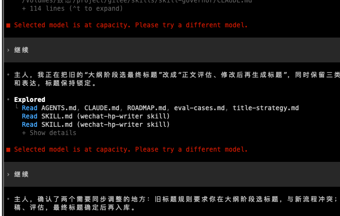
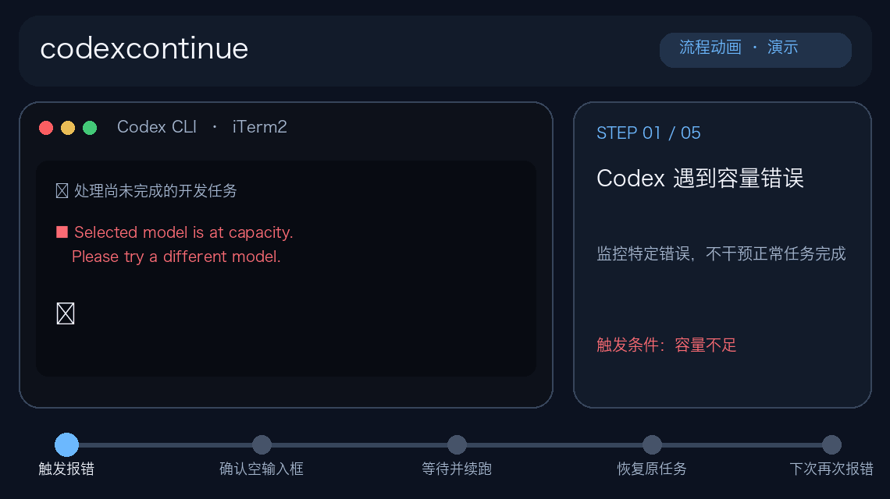
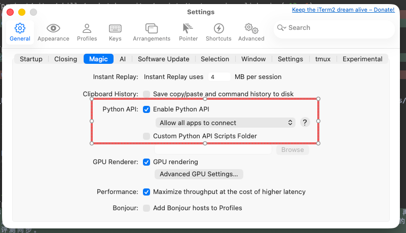

# codexcontinue

A small, **unofficial** watchdog for OpenAI Codex CLI running in **iTerm2 on macOS**.

When Codex displays:

~~~text
Selected model is at capacity. Please try a different model.
~~~

...and returns to an empty input prompt, the guard waits and sends a follow-up to **the same iTerm2 session**. It uses iTerm2's supported Python API instead of synthetic keystrokes or a Codex Stop hook.

[简体中文 / Chinese README](README.md)

## The problem

When Codex CLI stops after a model-capacity error, someone has to type "continue" to get it moving again.

This guard watches the specific capacity error in your active iTerm2 Codex session, then retries with a bounded delay.

**Animated workflow (illustration, not a real end-to-end recording):**

## Recommended: install by chatting with an AI

**No terminal experience needed**—if your AI assistant can actually access your Mac's files and shell (for example, a local Codex session, or ChatGPT with an authorized local-computer connector), copy and send this message:

~~~text
Please install the GitHub project https://github.com/twinsshehp/codexcontinue
on my Mac. Read AI_INSTALL.md and AGENTS.md from that repository first.
With my authorization, perform the environment checks, clone the repository,
install the tool, start its background service, and verify it is running.
Do not merely send me shell commands to copy. Do not stop my current
iTerm2/Codex tasks, bypass security prompts, or claim success without proof.
Ask me only when I must approve a macOS/iTerm2 permission.
Finally, report whether installation succeeded and what remains unverified.
~~~

**After installation the watchdog starts automatically. It exits when you quit iTerm2 (Cmd+Q), and starts automatically when you reopen iTerm2. There is no separate manual startup step.** The service and log commands below are optional checks for developers—not extra tasks every user must perform.

An ordinary web-only AI chat without local access **cannot** directly install software on your computer. The assistant must have an authorized tool to operate on your Mac.

See [AI installation instructions](AI_INSTALL.md) for the exact checklist and safe validation rules.

## First: enable the iTerm2 Python API

Open **iTerm2 → Settings → General → Magic**, then enable **Python API**:

You normally do not need to restart Codex. For the complete illustrated setup, see the [Chinese step-by-step guide](README.md).

## What it does

- Checks open iTerm2 sessions every **5 seconds**, filtering for foreground Codex jobs.
- Looks for the **specific model-capacity error** and an **empty Codex input prompt**.
- Uses an initial delay of **30 seconds**, followed by **60, 120, 240, and 300 seconds** between retries, up to **five** automated continuations per error episode.
- Re-checks the screen immediately before sending a message.
- Never intentionally approves commands, changes models, or bypasses Codex permissions.
- Persists retry counters, logs actions, and runs as a per-user macOS LaunchAgent.

> **Important:** Screen detection is heuristic. It may miss errors or mistake stale screen content for a live error in rare cases. The watchdog cannot guarantee that a task completes, and it has **not yet been end-to-end verified against a live model-capacity error**. It will not revive a terminated Codex process. Review the script before allowing it to type into your terminal.

## Requirements

- macOS with [iTerm2](https://iterm2.com/); enable **Settings → General → Magic → Enable Python API**
- Codex CLI running **inside iTerm2**, foreground program named codex
- Python **3.10+** with venv and pip
- An internet connection during installation for the iterm2 Python package

Codex Desktop, Terminal.app, tmux terminals outside iTerm2, and ChatGPT browser conversations are **not** supported.

## Manual installation (optional)

~~~bash
git clone https://github.com/twinsshehp/codexcontinue.git
cd codexcontinue
bash scripts/install.sh
~~~

**The installer already registers and starts the service—no second launch command is needed.**

The installer creates a private Python environment under
**~/Library/Application Support/CodexCapacityGuard/** and registers a user LaunchAgent.

You can keep your existing Codex CLI session running; no Codex restart is required. **Do not run multiple instances of the watchdog in parallel.**

## Check service status (optional)

~~~bash
# Service status
launchctl print gui/$(id -u)/com.peakmain.codex-capacity-guard

# Detection and retry events
tail -f ~/.local/state/codex-capacity-guard/supervisor.log

# Runtime errors
tail -f ~/.local/state/codex-capacity-guard/service.stderr.log
~~~

The guard does **not** need to display a terminal window. Startup appears in the log. It sends no message unless the error and prompt conditions are met. You can ask an AI with local Mac access to run the installed status script from **$HOME/Library/Application Support/CodexCapacityGuard/scripts/status.sh** instead of typing these commands yourself.

## Customize the continuation message

The default message is:

> Continue the previous unfinished task. Check the work already done first; do not repeat completed steps. Stop and ask the user if approval is needed.

You can add **CAPACITY_GUARD_MESSAGE** to the LaunchAgent's **EnvironmentVariables** dictionary if you prefer another one-line prompt; then reload the LaunchAgent. Don't use it to circumvent approvals.

## Stop, resume, or check status (no repository needed)

**Control scripts have a stable installed location on every user's Mac:**

~~~text
~/Library/Application Support/CodexCapacityGuard/scripts/
~~~

This is relative to the user's home directory. You do not need to know where the GitHub repository was cloned.

**Ask an AI that has authorized local Mac access:**

> Stop codexcontinue. On my Mac run `$HOME/Library/Application Support/CodexCapacityGuard/scripts/stop.sh`, then verify using status.sh in the same directory. Do not close iTerm2 or stop Codex. Stay disabled until I explicitly resume.

To resume:

> Resume codexcontinue using `$HOME/Library/Application Support/CodexCapacityGuard/scripts/start.sh`, then run status.sh to verify. Don't restart my Codex task.

To check:

> Check `$HOME/Library/Application Support/CodexCapacityGuard/scripts/status.sh` and show the latest continuation events. Do not automatically enable a previously stopped guard.

**Or run from any directory:**

~~~bash
bash "$HOME/Library/Application Support/CodexCapacityGuard/scripts/stop.sh"
bash "$HOME/Library/Application Support/CodexCapacityGuard/scripts/start.sh"
bash "$HOME/Library/Application Support/CodexCapacityGuard/scripts/status.sh"
~~~

Stop persists across iTerm2 restarts and Mac logins. Explicit resume reverses the opt-out. The control scripts remain available even if the original Git checkout is removed.

To uninstall entirely without the original repository, run the installed script from any directory:

~~~bash
bash "$HOME/Library/Application Support/CodexCapacityGuard/scripts/uninstall.sh"
~~~

## Tests

~~~bash
python3 -m unittest discover -s tests -v
~~~

Tests cover prompt matching, non-capacity errors, approval/busy states, user drafts, stale scrollback, backoff, retry limits, and reset behavior. They run without iTerm2.

## How it works

~~~text
iTerm2 Python API
    |
    +-- Is foreground job Codex CLI? -- no --> ignore
    |
    +-- Inspect terminal screen
         |
         +-- Capacity error AND empty prompt --> backoff
         |                                      |
         |                                recheck and send
         |
         +-- Anything else -------------------> do nothing
~~~

Logs and retry state stay local under **~/.local/state/codex-capacity-guard/**.
The guard needs no OpenAI API key and has no separate telemetry service.

## Limitations and safety

- iTerm2 Python API permissions must be enabled locally.
- If you type at the instant the guard sends text, there is a small race condition.
- The current matcher recognizes both `›` and the empty-input placeholder `› Ask Codex to do anything`; other UI changes may still break detection.
- The guard **sends the text and then a separate Enter key**. Sending the text plus a newline in one API call can leave the message unsubmitted in Codex CLI.
- New `Sent continuation (text + Enter)` logs mean both inputs were sent; earlier `Sent continuation` entries may only reflect text insertion. Neither guarantees successful model recovery.
- If the error is not on the visible terminal screen, it may not be detected.
- Five failed retries require manual attention; no automatic model switching.
- Codex Stop hooks may not fire for server overloads, so this tool observes iTerm2 directly.

## FAQ: After five failed retries, will it ever retry again?

**Yes, if the earlier capacity-waiting state has cleared for at least 120 seconds.** Five attempts is a limit for an ongoing error episode within the same iTerm2 session—not a permanent lifetime quota.

For example, Codex hits model capacity → guard automatically retries five times → you manually continue successfully → Codex is no longer at its capacity-error waiting prompt for at least **120 seconds** → a later capacity error starts a fresh episode with up to five new retries.

**Important caveat:** If the error returns **before the full 120-second clear interval**, the previous counter may still apply. If it was already exhausted, the guard may not try again. The process must remain running and observing that session to reset the counter normally.

## How do I see automatic "continue" history?

Ask an AI with access to your Mac:

> Read ~/.local/state/codex-capacity-guard/supervisor.log and summarize all recent "Sent continuation" events, timestamps, retry numbers and any "Maximum retries reached" events. Do not touch my Codex sessions.

Or run the bundled service-status script, which now shows the five most recent send events found in the current/rotated logs:

~~~bash
bash "$HOME/Library/Application Support/CodexCapacityGuard/scripts/status.sh"
~~~

To filter raw log lines:

~~~bash
grep 'Sent continuation' ~/.local/state/codex-capacity-guard/supervisor.log
~~~

- **Capacity error on session**: warning detected; initial retry wait begins.
- **Sent continuation**: the guard **attempted to send** text to the original iTerm2 session, with attempt number, e.g. 1/5.
- **Maximum retries reached**: the episode hit its cap.
- **Started: Codex CLI only**: the watcher has started, not necessarily sent anything.

"Sent continuation" proves a send call was attempted, **not** that Codex accepted it, successfully resumed or finished the task. The logs rotate (one current file and up to two backups), so the retained history is not permanent.

## Is it a timer? Does it consume resources? When does it stop?

It runs as **one background Python process** managed by a standard macOS per-user **LaunchAgent**. Python's **asyncio** event loop polls the iTerm2 Python API every **5 seconds**. It is **not a cron job** or a fresh process launched every five seconds.

In one observed macOS setup, the guard used about **22 MB resident memory (RSS)** and showed **0.0% CPU** at an idle instant. Usage varies with terminal window count, screen contents and host. The polling is lightweight, but not zero-cost. The watcher itself makes **no OpenAI model calls**; when it submits "continue", subsequent Codex work may use your model quota and local resources.

**The watchdog remains active while iTerm2 is running**, even when Codex is idle or closed. **Quit iTerm2 (Cmd+Q)** and the watchdog stops at its next check (normally within 5 seconds); reopening iTerm2 automatically restarts it. Closing one terminal window is not the same as quitting the app. The LaunchAgent has `KeepAlive=false` and does not continually respawn it. If the watcher itself crashes, reopening iTerm2 starts it again. On login, LaunchAgent may briefly check and exit if iTerm2 is closed.

The GIF is illustrative. Developers can regenerate it from the repository on macOS using **python3 scripts/render_flow.py** after installing Pillow; Pillow is not required to run the watchdog.

**License:** MIT. **Not affiliated with or endorsed by OpenAI or iTerm2.**
